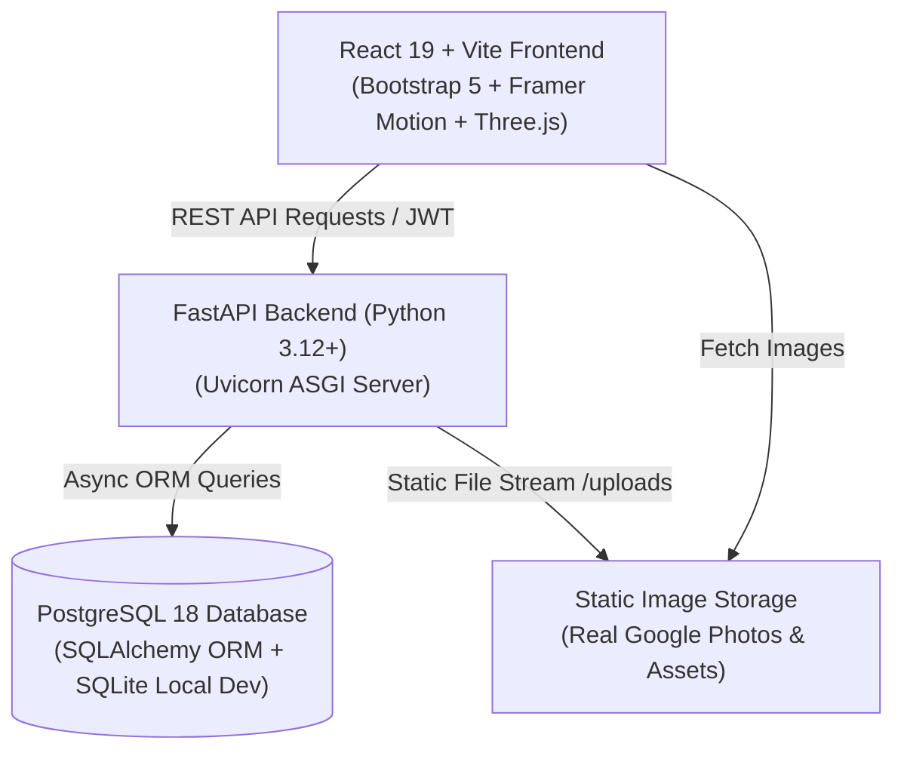
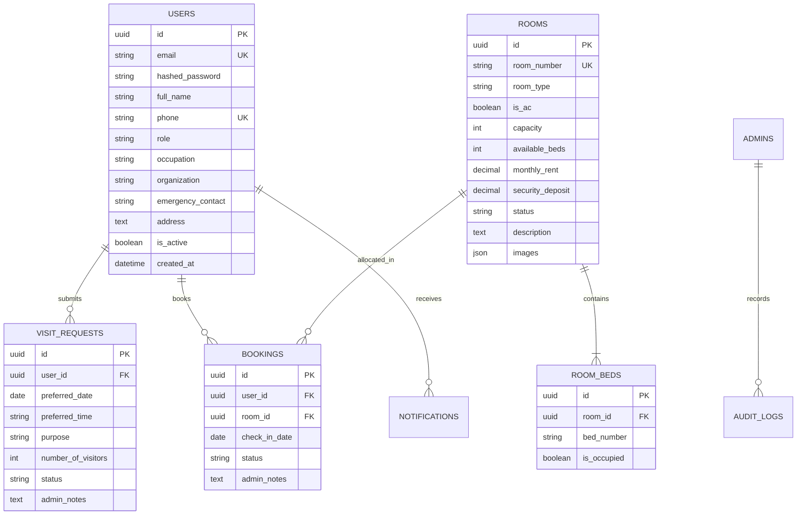

# SRI LAKSHMI SRINIVASA GENTS PG — Modern Full-Stack Management & Booking Platform

[](https://fastapi.tiangolo.com)
[](https://react.dev)
[](https://www.postgresql.org)
[](https://threejs.org)
[](https://www.docker.com)

A complete, production-grade web application and SaaS management portal built for **Sri Lakshmi Srinivasa Gents PG**, located at Bhavani St, Bharathi Nagar, Velachery, Chennai, Tamil Nadu – 600113.

Preserving the authentic identity and architectural feel of the real PG property (featuring real photos from Google Search & maps listings), this platform bridges real-world accommodation management with a high-performance web experience suitable for commercial deployment and portfolio demonstration.

---

## 🌟 Key Features

### 🏢 Public Experience
- **Real Property Showcase**: Incorporates authentic photographic assets of the Velachery property (building exterior, multi-cot bedrooms, signage, corridor) extracted from real Google listings, complemented by matching photorealistic renders.
- **Dynamic Catalog & Availability**: View AC & Non-AC rooms (Single, Double, Triple, Four Sharing) with real-time bed availability indicators.
- **Framer Motion & Three.js 3D**: Ambient 3D floating hostel/architectural geometry in hero header with smooth spring micro-interactions across components.
- **Lightbox Masonry Gallery**: Fullscreen image preview, zoom, navigation, and categorical tagging.
- **SEO & Structured Data**: Built with OpenGraph, Twitter Cards, Semantic HTML5, and Schema.org `LocalBusiness` / `Hostel` JSON-LD tags.
- **Interactive Map & Quick CTAs**: Embedded OpenStreetMap directions, direct click-to-call (`+91 78937 44206`), and WhatsApp chat trigger.

### 🛡️ Authentication & Authorization
- **Strict Business Logic Guard**: Public visitors can freely explore all pages without login. Login is required *only* when initiating visits or booking requests, triggering an elegant **Auth Required Modal** with `[Login]` and `[Create Account]`.
- **Role-Based Access Control (RBAC)**: Secure separation between regular resident accounts (`USER`) and PG staff/owners (`ADMIN`).
- **Secure Password Hashing**: Direct cryptographic `bcrypt` password salt & hash.
- **JWT Bearer Authentication**: Short-lived secure access tokens passed via HTTP Bearer headers.

### 📅 Visit Appointment System
- Configurable appointment time slots (09:00 AM to 06:00 PM).
- Conflict prevention avoiding overlapping bookings on the same date/slot.
- Full Admin lifecycle: `PENDING` ➔ `APPROVED` / `REJECTED` / `RESCHEDULED`.
- Instant notification dispatch to resident portal upon status update.

### 🛏️ Transactional Room Booking System
- Select room type, specific room, and preferred check-in date.
- **Double-booking Prevention**: Transactional server-side bed availability re-verification at the exact moment of admin approval.
- Automatic bed occupancy decrement upon booking confirmation.

### 📊 SaaS Admin ERP Portal
- **Real-Time KPI Metrics**: Total users, total rooms, occupied beds, pending visits, approved bookings, and occupancy percentage.
- **User Management**: Search, filter, view resident KYC info, emergency contact, college/workplace, and booking history.
- **Room Inventory**: Add, edit, or delete rooms; toggle AC status; configure pricing and deposits; set maintenance status.
- **Dynamic Content CMS**: Edit PG name, address, phone, Google maps coordinate, about story, rules, and FAQ on the fly without touching code.
- **Facility & Gallery CMS**: Toggle amenities, upload property photos, and set featured gallery banners.
- **Contact Message Inbox**: Read and manage public inquiries.

---

## 🏗️ System Architecture



---

## 🗄️ Database Schema (PostgreSQL 18)



---

## 🚀 Quick Start (Local Development)

### Prerequisites
- Python 3.11+
- Node.js 18+ & npm
- Git

### 1. Backend Setup
```bash
cd backend

# Create and activate virtual environment
python -m venv venv
# On Windows:
.\venv\Scripts\activate
# On Linux/macOS:
source venv/bin/activate

# Install dependencies
pip install -r requirements.txt

# Run the FastAPI server (auto-seeds default data on first launch)
python -m uvicorn app.main:app --host 127.0.0.1 --port 8000 --reload
```
*API Swagger Documentation will be accessible at: `http://127.0.0.1:8000/docs`*

### 2. Frontend Setup
```bash
cd frontend

# Install npm dependencies
npm install

# Start Vite development server
npm run dev
```
*Web application will be running at: `http://127.0.0.1:5173`*

---

## 🐳 Docker Deployment (Docker Compose)

To spin up the entire production stack (PostgreSQL 18, FastAPI backend, and Nginx frontend) with one command:

```bash
# From the root directory:
docker compose up --build -d
```

| Service | Port | Description |
|---|---|---|
| **Frontend Web** | `http://localhost:80` | Production React SPA served via Nginx |
| **Backend API** | `http://localhost:8000` | FastAPI REST service with Swagger Docs |
| **PostgreSQL 18** | `localhost:5432` | Relational database volume |

---

## 🔑 Default Seed Credentials

For evaluation and demonstration purposes, the system initializes with pre-configured accounts:

| Role | Email | Password | Access Level |
|---|---|---|---|
| **Administrator** | `admin@srilakshmipg.com` | `Admin@PG2026!` | Full ERP Portal (`/admin/*`) |
| **Resident / User** | `karthik.r@example.com` | `User@PG2026!` | Resident Portal (`/dashboard`) |

---

## 🧪 Automated Testing

Comprehensive API integration tests are included using `pytest` and `httpx`:

```bash
cd backend
pytest tests/ -v
```

**Test Coverage Highlights:**
- `test_health_and_info`: Confirms live status and property details.
- `test_user_registration_and_login`: Tests JWT token issuance and credential validation.
- `test_get_rooms_public`: Validates public access to room listings without authentication.
- `test_protected_user_routes_without_token`: Confirms rejection of unauthenticated access.
- `test_visit_request_lifecycle`: Verifies visit submission, duplicate detection, and admin approval.
- `test_booking_request_lifecycle`: Validates transactional booking and admin room allocation.
- `test_admin_authorization_barrier`: Guarantees normal users cannot access admin endpoints.

---

## 📍 Property Details

- **Property Name**: Sri Lakshmi Srinivasa Gents PG
- **Address**: 3, Bhavani St, Bharathi Nagar, Velachery, Chennai, Tamil Nadu – 600113, India
- **Contact Number**: +91 78937 44206
- **Operating Hours**: Open 24 Hours Daily
- **Target Demographic**: Working professionals and students in the Velachery – Taramani IT corridor.

---

## 📄 License
This project is licensed under the MIT License — open for commercial use and portfolio demonstrations.
